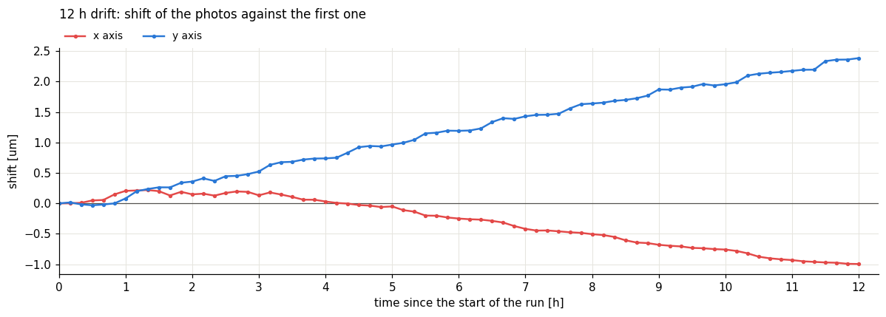
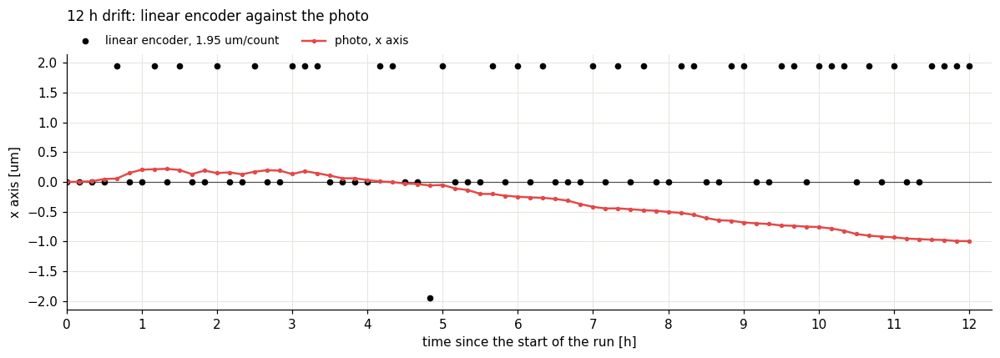
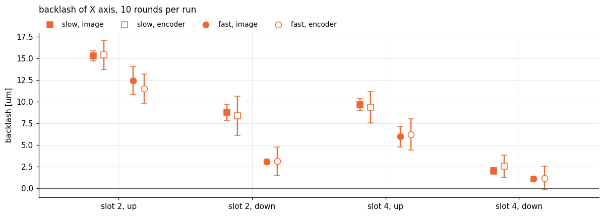
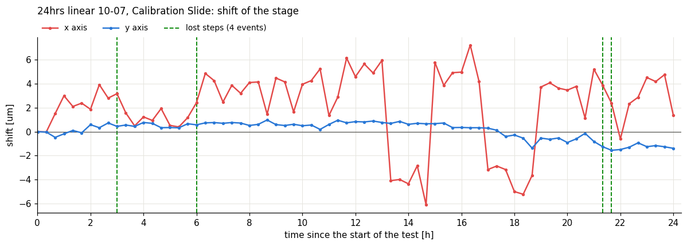
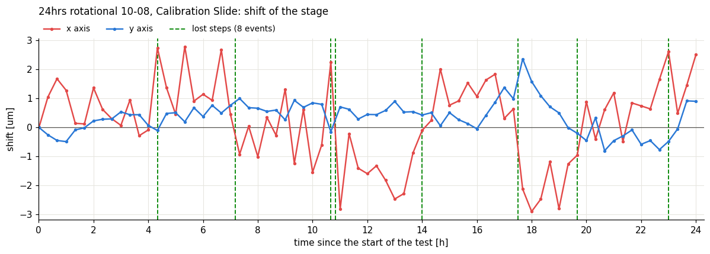
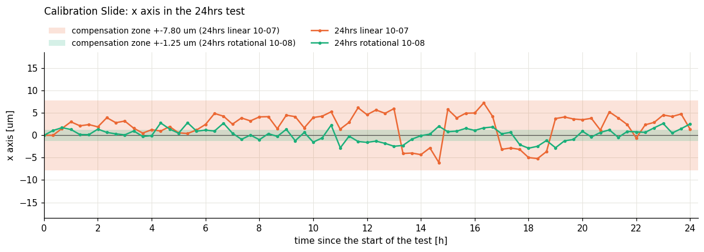
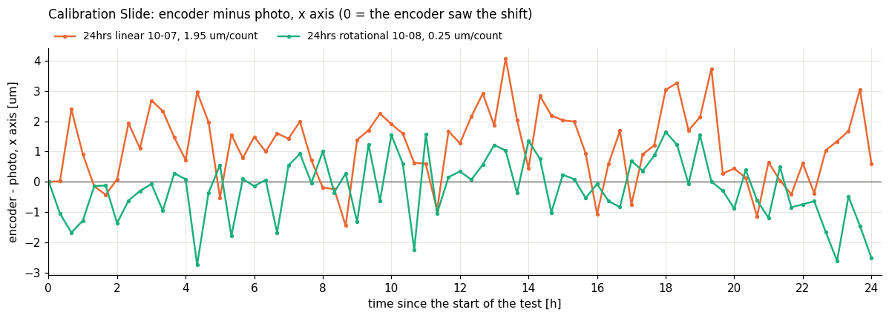
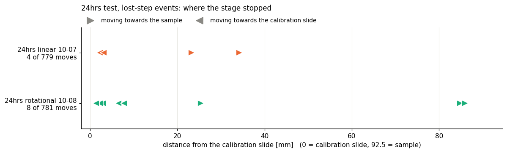

# Encoder test report

# 12hrs Thermal drift

- Setup: Frame 10, 20x objective lens, black dot on the calibration slide, linear encoder on X axis, room temperature
- Method: Take a picture of black dot on the calibration slide every 10 mins, runs for 12hrs, then use the first picture as a reference, calculate the shift distance along X and Y axis.
- Results:
    
    
    
    
    
    - thermal drift is around $0.1 \mu m/h$ along x axis(red line), $0.2\mu m/h$(blue line) .In previous experiment of thermal drift on Frame 9 with black dot, the drift is $1.5\mu m /h$ along x axis.
    - Linear encoder cannot see the thermal drift in experiment less than 12hrs

# Backlash test

- Setup: Frame 10, 20x objective lens, black dot on the calibration slide, room temperature
- Method: First, move in one direction for 256 steps, then take the first picture of the calibration slide. Move the motor 20,000 steps further, return to the starting position, and take another picture. Calculate the shift and compare it with the linear encoder.
    - Slow: speed 10,000 accel: 100,000
    - Fast: speed 100,000 accel: 1,00,000
- Result:
    
    
    
    - Backlash depends on position and speed; lower speeds, a centered position, and being closer to the motor result in higher backlash
    - The linear encoder can compensate for backlash at high speeds, but an error of 1–2 counts remains.

# 24hrs test

- Setup:  Frame 10, 20x objective lens, black dot on the calibration slide, Sample slide, linear or rotational encoder on X axis, room temperature, motor works in open loop (mode0), compensate by python script to find the best compensate zone and apply in firmware later
    - Speed: $100,000 steps/s$
    - Acceleration: $100,000steps/s^2$
- Method: A calibration slide is placed in the first slot and a sample in the fourth. The position of ROI is given, the stage moves to another target and take a picture every 10 minutes. add 2-5 times random movement between taking pictures of sample and calibration slide. All shift distance are acquired by camera and calibrated by calibration slide.
- Results:
    
    
    
    
    
    
    
    
    
    
    
    - The maximum deviation of real position and encoder reported is around 8 $\mu m$.Compensate range should be set at 4 counts for linear encoder
    - Linear encoder can keep the stage in compensation zone during 24hrs and recover from step loss events.